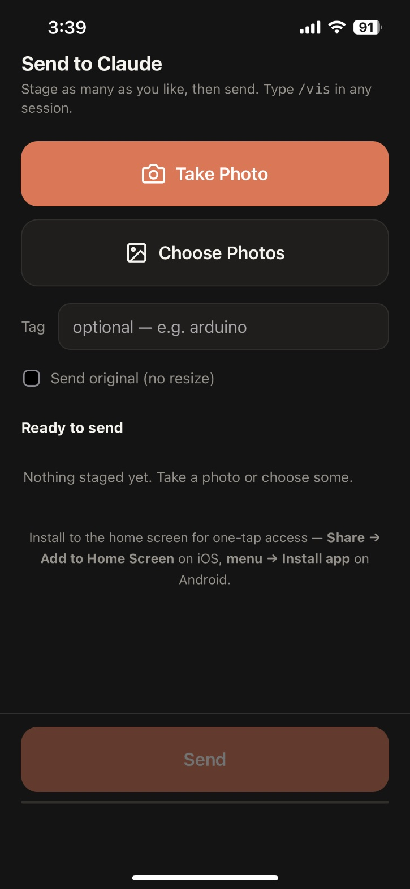

# claude_visual

[](LICENSE)

**A `/vis` command for [Claude Code](https://claude.com/claude-code).** Take a photo on your
phone, tap once, and it's in your session — no cloud round-trip, no copying paths.

Replaces: shoot → upload to cloud storage → download on the PC → find the file → copy the
path → paste it into the prompt.

Runs on macOS, Linux and Windows + WSL. Zero dependencies, nothing leaves your network.

<p align="center">
  
</p>
<p align="center">
  <sub>The page you install to your home screen. Stage photos, then send them as one batch.</sub>
</p>

---

## Installing

Works on **macOS**, **Linux** and **Windows + WSL**. You need:

- **[Claude Code](https://claude.com/claude-code)** — this installs a `/vis` slash command
  into it. It's an extension to Claude Code, not a standalone tool.
- **Node**, any recent version. The project has **zero dependencies**, so there is nothing to
  `npm install`.
- Your **phone on the same Wi-Fi** as the computer.

Windows is the only platform with a wrinkle, covered below.

### Common steps

```bash
git clone <repo> claude_visual        # or just copy the folder
cd claude_visual
node bin/install.js                   # add --autostart to start it with the machine
```

The installer detects the platform and adapts. It creates `.env`, and generates the `/vis`
command at `~/.claude/commands/vis.md` pointing at *this* checkout — that file has to be
generated rather than copied, because it contains an absolute path that differs per machine.
It also repairs `~/.claude/commands` if it's a dangling symlink into a dotfiles repo, which
otherwise silently stops **all** custom slash commands from loading.

Re-run it any time; it's idempotent, and backs up an existing `vis.md` before replacing it.

Then start the receiver and note the URL it prints:

```bash
./start-server.sh                     # macOS / Linux
```

It prints one URL per network interface, best first, flagging the ones a phone can't reach
(VPN tunnels, Docker bridges, the WSL vSwitch). Take the top one — it looks like
`http://192.168.1.50:8765/?k=AbC123`.

Finally, open that URL — **including the `?k=…` part** — in the phone's browser and install
it to the home screen: **Share → Add to Home Screen** on iOS, **menu → Install app** on
Android.

### macOS

Nothing extra. The first run triggers *"Do you want the application node to accept incoming
network connections?"* — say **Allow**, or the phone gets a connection refused.

`--autostart` installs a LaunchAgent at `~/Library/LaunchAgents/com.claudevisual.receiver.plist`
with `KeepAlive`, so it restarts if it ever dies. Remove it with:

```bash
launchctl unload ~/Library/LaunchAgents/com.claudevisual.receiver.plist
rm ~/Library/LaunchAgents/com.claudevisual.receiver.plist
```

### Linux

If the phone can't connect, open the port:

```bash
sudo ufw allow 8765/tcp               # or firewall-cmd --add-port=8765/tcp
```

`--autostart` installs a systemd **user** service (`~/.config/systemd/user/claude-visual.service`).
On a machine you don't stay logged into, add `loginctl enable-linger $USER` so it survives
logout. Remove it with:

```bash
systemctl --user disable --now claude-visual.service
rm ~/.config/systemd/user/claude-visual.service
```

### Windows + WSL

Here the receiver runs as a **Windows** process while `/vis` runs inside WSL. That's
deliberate: WSL2 is NAT'd, so a server started *inside* WSL isn't reachable from the phone
without a `netsh portproxy` that breaks every time WSL's IP changes. A Windows-side process
binds the real LAN address and just works.

Two consequences:

- **Install Node for Windows too** ([nodejs.org](https://nodejs.org)), not just in WSL. The
  installer checks for it.
- **The project must live on a Windows drive** — `/mnt/c/...`, `/mnt/d/...` — so both halves
  see the same files. A checkout at `~/code/` inside the WSL filesystem cannot work, and the
  installer refuses it rather than letting it fail confusingly later.

```bash
cd /mnt/d/code && git clone <repo> claude_visual && cd claude_visual
node bin/install.js
```

Start it by double-clicking `start-server.cmd` (not the `.sh`). `--autostart` puts a shortcut
to `start-hidden.vbs` in `shell:startup`, which runs it with no console window.

Windows usually prompts to allow it on first run. If it didn't and the phone can't connect,
from an **elevated** PowerShell:

```powershell
New-NetFirewallRule -DisplayName "claude_visual" -Direction Inbound `
  -LocalPort 8765 -Protocol TCP -Action Allow -Profile Private,Public
```

Both profiles — home Wi-Fi is often categorized Public rather than Private. Check with
`Get-NetConnectionProfile`.

### Verifying

```bash
curl -s http://<your-ip>:8765/health      # -> ok
node test/netrank.test.js && node test/page-token.test.js && node test/page-tray.test.js
```

Then send a photo from the phone and type `/vis` in any Claude Code session. If `/vis` isn't
recognised, restart Claude Code — user-level commands are picked up at session start.

### Adapting it

Change the port, resize target, or the `/vis` time window in `.env` (see
[Configuration](#configuration)). Nothing outside `.env` is machine-specific once the
installer has run.

If platform detection ever guesses wrong, force it:
`CLAUDE_VISUAL_PLATFORM=mac|linux|wsl|windows`.

---

## Where things live

| | |
|---|---|
| Phone URL | printed by the server on startup — `http://<your-lan-ip>:<port>/?k=<token>` |
| Access token | `server/token.txt`, generated on first run |
| Inbox | `<project>/inbox` (on Windows, also reachable as the `D:\…` form of the same path) |

### One-time, on the phone

Any modern mobile browser works — iOS Safari, Chrome, Firefox. Nothing here is
Safari-specific.

1. Same Wi-Fi as the computer. Open the URL — **including the `?k=…` part**.
2. Install it to the home screen: **Share → Add to Home Screen** (iOS) or
   **menu → Install app** (Android). Name it `Claude`.
3. Done. Tap the icon → **Take Photo** / **Choose Photos** → then **Send**.

**The token stays in the URL on purpose.** Installing saves whatever URL is showing, and on
Android the manifest's `start_url` carries it too. If the icon ever opens to a **"paste your
token"** box, it was installed without the token — paste the value from `server/token.txt`
once and it's fixed, no need to delete and reinstall.

Why it can't just be remembered from your browsing session: an installed standalone web app
gets its **own localStorage partition**, separate from the browser's. A token cached while
browsing is invisible to the installed app. Hence the token living in the URL.

---

## Staging, then sending

Photos don't upload the moment you pick them. They land in a **tray**
([screenshot](#claude_visual)), and go up when you press **Send**:

- **Take Photo** repeatedly — each shot adds to the tray, no app-switching.
- **Choose Photos** — multi-select from the library, all added at once.
- Tap **&times;** on any row to drop it, or **clear all** to start over.
- **Send** uploads the whole tray as **one request**, so every photo shares a timestamp and
  arrives as a single coherent set for `/vis`.

The Send button is sticky at the bottom and carries a live count ("Send 3 photos") — the
one failure mode of staging is walking away without pressing it.

Photos are resized when **staged**, not when sent, so a full tray costs ~300 KB per photo
instead of ~4 MB, and Send is pure upload with no decoding in the way.

If a send fails, the tray is left intact — just press Send again.

## Using it

| You type | You get |
|---|---|
| `/vis` | everything sent in the last 30 minutes |
| `/vis 3` | the newest 3, ignoring the time window |
| `/vis all` | everything pending, however old |
| `/vis arduino` | everything pending tagged `arduino` |

### Why a single global inbox doesn't get confused

The inbox is a **queue, not a library**. `/vis` *claims* what it takes — moves it out of
`inbox/` into `archive/YYYY-MM/`. So `inbox/` only ever holds "sent but not yet used",
which is almost always the one photo you took twenty seconds ago. Proximity in time does
the routing; there is nothing to configure.

Three guards cover the rest:

- **30-minute window.** Bare `/vis` will not touch anything older. Stale photos are
  *listed*, not read, so last week's screenshot can never leak into an unrelated session.
- **Manifest first.** Claude sees filenames, ages and tags before reading anything.
- **Claude looks at the picture.** If the content obviously isn't this project's, it says so.

For deliberate pre-staging, put a word in the **Tag** box on the upload page. It sticks
(localStorage), tags every upload, and `/vis <tag>` filters to it. Ignore it and nothing changes.

---

## What happens to a photo

Modern phones shoot HEIC at ~4 MB — Claude can't read HEIC, and it downsamples anything
over 1568px anyway. So the page re-encodes in the browser before upload: decode → fit to
1568px long edge → JPEG q0.85. HEIC becomes readable, uploads finish in a blink, and no
detail Claude would have used is lost. Tick **Send original** to bypass it.

This is done with `createImageBitmap` + canvas, which every current mobile browser supports.
If the browser can't decode the format, the original file is uploaded untouched rather than
failing — and if a HEIC does land that way, `/vis` says so instead of handing Claude a file
it can't open.

---

## Configuration

Everything tunable lives in `.env` (copy of `.env.example`, gitignored). A real environment
variable beats the file, so you can override for a single run:

```bash
CLAUDE_VISUAL_WINDOW_MIN=120 node bin/claim.js
```

The ones you're most likely to touch:

| Variable | Default | Effect |
|---|---|---|
| `CLAUDE_VISUAL_WINDOW_MIN` | `30` | how far back a bare `/vis` reaches |
| `CLAUDE_VISUAL_MAX_EDGE` | `1568` | browser downscale target; 1568 is the largest edge Claude uses |
| `CLAUDE_VISUAL_JPEG_QUALITY` | `0.85` | re-encode quality |
| `CLAUDE_VISUAL_PORT` | `8765` | changing it changes the phone URL |
| `CLAUDE_VISUAL_TOKEN` | *(generated)* | pin the token instead of using `server/token.txt` |

Server-side values need a restart to take effect. `CLAUDE_VISUAL_WINDOW_MIN` is read by
`claim.js` per invocation, so it applies immediately.

`CLAUDE_VISUAL_INBOX_DIR` / `ARCHIVE_DIR` take **relative names only** — the same value has
to resolve for Windows node (`D:\...`) and WSL node (`/mnt/d/...`), and only a relative name does.

## Running it

```
./start-server.sh    macOS / Linux
start-server.cmd     Windows — visible console, shows the phone URL and token
start-hidden.vbs     Windows — no console window; this is what autostart runs
```

Check it's alive: `curl -s http://<your-ip>:<port>/health` → `ok`

To stop it:

- **macOS / Linux** — `Ctrl-C`, or if it's running under launchd/systemd, unload or
  `systemctl --user stop claude-visual`.
- **Windows** — end the `node.exe` running `server\server.js`. Find the right PID with
  `Get-CimInstance Win32_Process -Filter "Name='node.exe'"`; don't blanket-kill `node.exe`,
  you may have others.

Autostart locations, if you used `--autostart`:

| Platform | Path |
|---|---|
| macOS | `~/Library/LaunchAgents/com.claudevisual.receiver.plist` |
| Linux | `~/.config/systemd/user/claude-visual.service` |
| Windows | `%APPDATA%\Microsoft\Windows\Start Menu\Programs\Startup\claude_visual.lnk` |

---

## Tests

```bash
node test/netrank.test.js       # which address to hand the phone
node test/page-token.test.js    # token handling
node test/page-tray.test.js     # staging tray
```

`netrank` presents synthetic Windows, macOS and Linux machines — Docker bridges, libvirt,
VPN tunnels, AirDrop interfaces, Tailscale — and checks the top-ranked address is the one a
phone can actually reach. It's pure logic, so one machine can verify all three platforms.

The page tests run the upload page's inline script against a stub DOM, since the real paths
only happen on an iPhone.

`page-token` covers all four token paths (in URL / storage only / absent / pasted in). It
exists because an early version stripped `?k=` from the URL for tidiness, which silently
produced a home-screen icon that could never authenticate.

`page-tray` covers staging, the live count on the Send button, removing one, and clearing all.

## Things that will eventually bite

**The LAN IP can move.** It's DHCP. If the bookmark dies, run
`start-server.cmd` and read the new URL off the console. Permanent fixes: a DHCP
reservation on the router, or Tailscale (below).

**Off your home Wi-Fi it won't work.** By design — nothing is exposed to the internet.

**Tailscale is installed on this PC but not signed in.** Sign in there and on the iPhone
and you get a stable `100.x` address plus a MagicDNS name: the *same server and same
home-screen icon* then work from mobile data or any other network, with no port
forwarding and no photos transiting a third party. The server already ranks a Tailscale
address above the Wi-Fi one, so it'll recommend the right URL automatically.
Caveat: CloudflareWARP and Tailscale can fight over routes — if things get strange,
WARP is the one to turn off.

**If the firewall ever starts blocking it** (e.g. the network gets re-categorized as
Private), in an elevated PowerShell:

```powershell
New-NetFirewallRule -DisplayName "claude_visual" -Direction Inbound `
  -LocalPort 8765 -Protocol TCP -Action Allow -Profile Private,Public
```

---

## Layout

```
config.js             every tunable, read from .env; also platform detection
server/server.js      HTTP receiver, token auth, magic-byte validation, app icon
server/page.js        the mobile upload page (self-contained, no external requests)
server/multipart.js   zero-dep multipart/form-data parser
server/netrank.js     picks which of the machine's addresses to hand the phone
bin/claim.js          claims pending images, prints absolute paths for the Read tool
bin/install.js        one-time setup — platform-aware, generates /vis for this checkout
test/                 tests (pure logic + stub-DOM; no browser or second machine needed)
start-server.sh       launcher for macOS / Linux
start-server.cmd      launcher for Windows (+ start-hidden.vbs for no console window)
inbox/                transient queue — only unclaimed images
archive/YYYY-MM/      claimed images, kept so they can be re-read later
manifest.jsonl        append-only log of every upload and claim (incl. claiming project)
```

The `/vis` command itself is generated by `bin/install.js` into `~/.claude/commands/vis.md`
— user-level, which is what makes it available in every project on the machine.

Uploads are validated by magic bytes, not by filename or declared content-type, and are
capped at 25 MB. Every request except `/health` needs the token.

---

## Contributing

Contributions welcome. A few things that will save you time:

- **Zero dependencies is a hard constraint.** No `npm install`, no build step. If something
  needs a library, it probably needs a different design — the multipart parser, PNG icon
  writer and `.env` loader are all hand-rolled for this reason.
- **Run the tests** before opening a PR: `node test/netrank.test.js && node test/page-token.test.js
  && node test/page-tray.test.js`. They're plain Node, no runner.
- **The upload page can't be tested in a browser here**, so its logic is exercised against a
  stub DOM. If you change `server/page.js`, extend those tests — two real bugs have shipped
  through that gap already.
- `PROJECT_SPEC.md` carries the design rationale and the open work. Worth reading first.

## Licence

[Apache License 2.0](LICENSE).

You're free to use, modify and distribute this, including commercially. In return, Apache-2.0
asks that you keep the licence and copyright notices, state what you changed, and — per
section 4(d) — **reproduce the contents of [NOTICE](NOTICE)** in the documentation or
materials you distribute. If you build on this, that's the attribution to carry forward.
